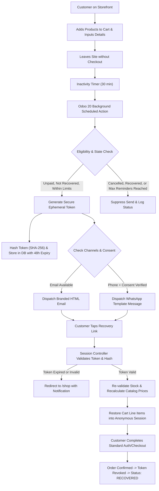

# Stephan's Pet Store • Abandoned Cart Multi-Channel Recovery
## Security-Hardened UI/UX & Architecture Specification

---

### 1. Executive Architecture & Lifecycle Flow

This specification defines the multi-channel abandoned cart recovery workflow for Stephan's Pet Store (`stephanspetstore.co.tz`), operating across **branded email** and **opt-in WhatsApp notifications**.



---

### 2. Security & Compliance Architecture

#### A. Token Security & Lifecycle Management
1. **Generation & High Entropy**:
   - Tokens are generated using Python's cryptographically secure random generator:
     ```python
     raw_token = secrets.token_urlsafe(32)
     ```
2. **Storage via One-Way Hash**:
   - Plaintext tokens are **never stored** in the database.
   - Odoo stores only the **SHA-256 hash** (`abandoned_cart_token_hash = hashlib.sha256(raw_token.encode()).hexdigest()`).
   - Lookups compare the incoming token's hash against the stored hash in constant time (`hmac.compare_digest`).
3. **Strict Time Limits (Expiration)**:
   - Tokens carry an explicit expiration timestamp (`token_expiry = fields.Datetime.now() + timedelta(hours=48)`).
   - Any request submitted after 48 hours is rejected, triggering a clean redirect to `/shop` with an informational notice: *"Your cart session has expired. Browse our catalog for fresh pet essentials."*
4. **Single-Use Invalidation & Revocation**:
   - The token hash is immediately cleared (`abandoned_cart_token_hash = False`) upon:
     - Successful checkout confirmation (`action_confirm`).
     - Order cancellation (`action_cancel`).
     - Explicit cart abandonment expiration.

#### B. Identity, PII & Payment Isolation
1. **Contents-Only Cart Restoration**:
   - The recovery link restores **only** line items (`product_id`, `quantity`, `custom_options`) into the visitor's HTTP web session (`request.session['sale_order_id']`).
   - The recovery link does **NOT** log the visitor in as the partner, nor does it grant access to the customer portal (`/my`), order history, or saved user settings.
2. **Zero PII Exposure on Landing**:
   - Customer shipping addresses, phone numbers, notes, and billing records are **not** pre-filled or rendered to unauthenticated visitors clicking the link.
   - Address details appear only after the customer completes standard portal authentication (e.g. WhatsApp OTP, password) or explicitly verifies their checkout credentials.
3. **Payment Method Isolation**:
   - Saved payment methods, tokenized cards, and M-Pesa details are **never** restored, serialized, or exposed via recovery links. All payment flows require fresh customer selection and authorization at payment gateway time.

#### C. Real-Time Price & Stock Re-validation
Before restoring cart lines into the session, the controller performs mandatory catalog re-validation:
1. **Inventory Stock Check**:
   - Validates `qty_available` and `virtual_available` for each line item.
   - If an item went out of stock while the cart was idle:
     - The line is cleanly adjusted or removed.
     - A notification toast alerts the customer: *"Note: [Product Name] sold out while your cart was reserved. We updated your cart with remaining available items."*
2. **Price & Tax Recalculation**:
   - Cart unit prices are dynamically recomputed against the active pricelist and catalog.
   - Prevents stale pricing or outdated promotional discounts from persisting past their validity window.

#### D. WhatsApp Compliance, Consent & Opt-Out Governance
1. **Recorded Opt-In Consent**:
   - WhatsApp recovery messages are only sent to customers who have an explicit opt-in record (`whatsapp_opt_in = True` on `res.partner`) or who provided their phone number during storefront checkout with marketing/service consent.
2. **Template Pre-Approval**:
   - Messages must conform strictly to WhatsApp Business Messaging Policies (Utility / Marketing category with approved template text).
3. **Mandatory Opt-Out Mechanism**:
   - Every WhatsApp message includes an explicit, easy opt-out mechanism:
     *"Reply STOP to unsubscribe from cart reminders."*
   - Incoming "STOP", "UNSUBSCRIBE", or "SIMTUMIWI" keywords received via the webhook automatically set `res.partner.whatsapp_opt_out = True`, suppressing all future automated communications.
4. **Strict Rate & Retry Limits**:
   - Maximum **2 WhatsApp reminders** per abandoned cart.
   - Minimum interval of **24 hours** between reminder 1 and reminder 2.

#### E. Comprehensive Audit Trail (`abandoned.cart.log`)
Every interaction is recorded in `abandoned.cart.log`:
- **Actor**: Automated Cron (`ir.cron`) vs. Manual Staff Member (`user_id`).
- **Channel**: `email`, `whatsapp`, or `multi_channel`.
- **Timestamp**: Precise UTC dispatch timestamp.
- **Delivery Status**: `sent`, `delivered`, `failed` (with sanitized error details).
- **Token Lifecycle Events**: Token generated, token validated, token revoked, cart restored, order converted.

---

### 3. Branded Multi-Channel UI/UX Specifications

#### A. Branded Recovery Email UI/UX
- **Visual Aesthetic**: Stephan's Pet Store luxury brand styling:
  - Header: Deep roast espresso (`#3E220F`), Stephan's pug mascot mark, Masaki & Mikocheni store badges.
  - Accent: Warm amber gold (`#C77E35`).
  - Card Canvas: Clean off-white card (`#FFFFFF`) on muted neutral background (`#FAF8F5`).
- **Dynamic Content**:
  - Itemized product card list with clear thumbnails, product variants (e.g. 10kg, 6L), quantities, and formatted TZS pricing.
  - Clear Cart Summary with subtotal and Free Delivery qualification status.
- **Primary CTA**: Single prominent, accessible button:
  `[ Complete Your Order Now → ]`
  *(URL: `https://stephanspetstore.co.tz/shop/cart/recovery/<raw_token>`)*
- **Footer Reassurance**:
  - Free delivery on orders over TZS 100,000 in Dar es Salaam.
  - Accepted payment badges: M-Pesa, Airtel Money, Tigo Pesa, Visa/Mastercard, Cash on Delivery.
  - Clear unsubscribe link for email communications.

#### B. Branded WhatsApp Recovery UI/UX
- **Tone**: Conversational, respectful, helpful.
- **Copywriting**:
  ```text
  Stephan's Pet Store • Dar es Salaam
  Hello Juma,

  We noticed you left some essentials in your shopping cart on stephanspetstore.co.tz:

  • Summit 10 Whole Choice Puppy 10kg (x1) — TZS 185,000
  • Bioline Tofu Cat Litter 6L (x2) — TZS 52,000
  ─────────────────────────
  Cart Total: TZS 237,000 (Qualifies for Free Delivery in Dar es Salaam)

  To review your items and complete checkout, tap your secure recovery link below:
  https://stephanspetstore.co.tz/shop/cart/recovery/r_k8A2v91Lm0Pq

  Need help or prefer ordering directly? Reply to this message and our pet care team will assist you right away.

  Reply STOP to opt out of reminders.
  ```

#### C. Shopper Cart Restoration Landing Experience
1. **Frictionless Entry**:
   - Tapping the recovery link in an email or WhatsApp chat opens the browser directly to `/shop/cart`.
   - The cart displays restored items with up-to-date pricing and current stock confirmation.
2. **Reassurance Banner**:
   - A friendly notification banner confirms:
     *"Welcome back! We restored your saved items. Ready when you are."*
3. **Privacy by Design**:
   - The delivery address and billing sections remain blank or require standard customer login / checkout confirmation before display.
4. **Checkout Transition**:
   - One-click progression to checkout with immediate access to local mobile money and card gateways.

---

### 4. Back-Office Admin & Staff UX in Odoo 20

- **Dedicated Menu**: **Website > Orders > Abandoned Carts** and **Lucy Dashboard > Catalog Tracker**.
- **Action Buttons**:
  - **`[ Send Email Reminder ]`**: Manually dispatch a branded email reminder with audit logging.
  - **`[ Send WhatsApp Reminder ]`**: Manually dispatch an approved WhatsApp template with consent verification.
- **Lifecycle Statuses**:
  - `Draft / Active Cart` ➔ `Abandoned` ➔ `Reminder Sent` ➔ `Recovered` (or `Expired` / `Cancelled`).
- **Revenue Analytics**:
  - Tracks total abandoned pipeline value (TZS) vs. recovered revenue (TZS).
  - Attribution tracking shows whether recovery was completed via Email or WhatsApp.
